<p align="center"></p>
<h1 align="center">GridRescue AI</h1>
<p align="center"><strong>Map the grid. Keep the theatres on. Move with the hospital.</strong><br/>
An open-source planner that turns a map pin into a tested, costed and relocatable clean backup-power plan for a hospital or other critical facility on a weak grid, with an ESG estimate, from open data.</p>

<p align="center">
<b>Team Secure AI Grid</b> · Pavan Manjunath (<a href="https://orcid.org/0000-0002-2694-8807">ORCID 0000-0002-2694-8807</a>) · Thomas Prüfer<br/>
Global Energy Hackathon 2026 · Clean Energy Solutions · Brief 12 “Relocatable solar for a hospital on the move”
</p>

<p align="center">
<a href="https://github.com/pavangemmanjunath-cell/GridRescue_AI/actions/workflows/ci.yml"></a>
<a href="LICENSE"></a>
<a href="CITATION.cff"></a>


</p>

<p align="center">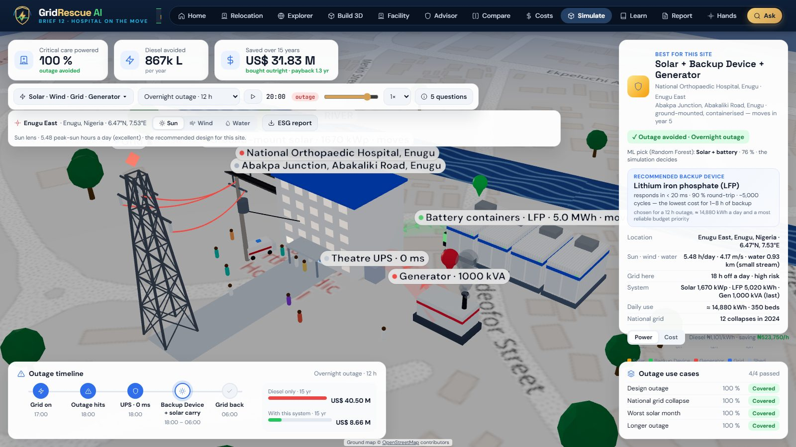</p>

## Key results — National Orthopaedic Hospital, Enugu (worked example)

| Theatres and ICU | Diesel avoided | CO₂ avoided | Upfront and fee | 10-year cost | After the move |
|:---:|:---:|:---:|:---:|:---:|:---:|
| **303 kW on a 0 ms UPS**<br/>4 of 4 stress tests · survives any outage start, up to 24 h | **866,678 L**<br/>a year (83 %) | **2,246 t**<br/>a year, net | **₦0 upfront**<br/>fee ₦69.1 M a month vs ₦299 M of diesel | **₦15.9 bn**<br/>vs ₦37.6 bn staying on diesel | **88 % reused**<br/>move ₦678 M vs ₦1,510 M stranded on a roof |

<sub>Engine results for the worked example — 1,670 kWp ground-mounted solar · 5,020 kWh in 3 movable battery containers · 500 kVA UPS · the existing generator last — from live open data and the hospital's reported 6 h of grid a day (reproduce with `python examples/quickstart.py`). The diesel bill is modelled; the service saves money from month one whenever the real bill is above ₦117.9 M a month (the hospital's records are partner data still to come). CO₂ net = 2,323 t of diesel no longer burnt − 77 t of extra grid power bought to charge the batteries.</sub>

### Brief 12 — every deliverable, and where to see it

| The brief asks for | In the app | Tested in |
|---|---|---|
| Critical-load list, theatres powered first | Plan › Theatres first (303 kW critical, phases) · Simulate (UPS 0 ms) | `enugu.spec.ts` |
| Relocatable design with a move plan | Plan › Movable storage, Move plan (4 km, 3 weeks, 88 % reused) · new-site lens | `enugu.spec.ts`, `location-sim.spec.ts` |
| Ownership and financing that fit federal asset rules | Plan › Money (energy-as-a-service, nothing on the asset register) | `enugu.spec.ts` |
| Diesel vs grid vs solar over 5 and 10 years | Plan › Money (₦18.8 / 3.5 / 7.9 bn at 5 yr; ₦37.6 / 7.0 / 15.9 bn at 10 yr) | `enugu.spec.ts`, `qa.spec.ts` |
| Funders named, with the case for each | Plan › Money (REA public-sector solarisation, EU–Enugu Solar for Health, development banks, an ESCO) | `enugu.spec.ts` |
| Uninterrupted theatres incl. switchover; diesel kept until proven | UPS 0 ms; 4 stress tests; outage survival at every start hour; generator last | `app.spec.ts`, `qa.spec.ts` |

---

## Contents
1. [Overview](#overview) · [Proposition](#proposition) · [Research problem and motivation](#research-problem-and-motivation) · [Key contributions](#key-contributions) · [How this work differs](#how-this-work-differs)
2. [The journey in the app](#the-journey-in-the-app) · [Simulation types](#simulation-types) · [ESG report for any site](#esg-report-for-any-site)
3. [System architecture](#system-architecture) · [Data flow](#data-flow) · [Methodology](#methodology)
4. [Installation and quick start](#installation-and-quick-start) · [Usage](#usage) · [Dataset](#dataset) · [Reproducing the research](#reproducing-the-research) · [Benchmarks](#benchmarks) · [Tests](#tests)
5. [Demo and submission package](#demo-and-submission-package) · [How it scales](#how-it-scales) · [Known limitations](#known-limitations)
6. [**Call for contributions**](#call-for-contributions) · [API](#api) · [Open data sources](#open-data-sources) · [Repository structure](#repository-structure)
7. [Research paper](#research-paper) · [Software citation](#software-citation) · [Research impact and adoption](#research-impact-and-adoption) · [Contributing, roadmap, security and support](#contributing-roadmap-security-and-support) · [License](#license) · [Authors](#authors)

---

## Overview

**The problem.** The National Orthopaedic Hospital in Enugu gets about **6 hours of grid power a day**, diesel costs **₦3,277 a litre** (up 86 % in a year), every switchover damages equipment, and the hospital **moves to a new building in about five years** — so solar bolted to today's roof would be stranded. The same squeeze hits hospitals, clinics and utilities across weak-grid regions, and buyers face dozens of energy systems with no neutral way to compare them.

**What GridRescue AI does.** Drop a pin, and the app reads the site from open data (sun, wind, water, the grid within 50 and 100 km, the published tariff), sizes and compares every clean option against that site, simulates each one **hour by hour through real outage cases**, and returns a plan a hospital board can act on — framed by the hackathon's three tests:

| | What it means | What GridRescue AI does |
|---|---|---|
| **Access** | Reliable power where the grid fails | Reads any site in seconds from open data; the new-site lens ranks where the next building should go by grid access |
| **Affordability** | Clean power within reach | Compares every storage family on cost for *this* site; energy-as-a-service with no upfront capital, paid from today's diesel budget |
| **Availability** | Never dark, anytime | A 0 ms UPS on the theatres, storage through the night, diesel last; four outage stress tests must all pass; the system moves with the hospital |

**Who it helps.** Hospital boards and engineers (what to buy, why, what it costs, how it moves), funders (bankable numbers, ESG forecast before purchase), utilities (where feeders are weak, grid-first options), and installers of any brand — the planner is **vendor-neutral** and sells no hardware.

**Worked example.** The National Orthopaedic Hospital, Enugu — results in [Key results](#key-results--national-orthopaedic-hospital-enugu-worked-example) above. Nothing is hard-coded to it: the same flow runs for any pin (tested for Kano, Jos and Lokoja).

---

## Proposition

**For** hospital boards, engineers, funders and utilities on weak grids **who** must decide what backup power to buy before a full engineering study exists, **GridRescue AI** is an open, vendor-neutral planner that **turns a map pin into a tested, costed, relocatable backup-power plan and an ESG estimate in seconds**. It compares every storage family on one basis, proves each option hour by hour through real outage cases, and keeps the evidence and sources beside every number. It is the same-day first answer that a full study then confirms; it does not replace that study.

| Who | What they get |
|---|---|
| **Hospital board** | What to buy, why, what it costs over 5 and 10 years, how it moves with the hospital, and the ESG effect before anything is bought |
| **Engineer** | Sizes, an hourly energy balance, four stress tests and an outage survival curve to check, with every assumption visible |
| **Funder** | Figures with sources, an ownership model that fits public-sector asset rules, Scope 1 and Scope 2 estimates |
| **Utility** | Where feeders are weak and where grid-first options are viable |
| **Researcher** | An open, reproducible pipeline, a seeded ML evaluation and a worked example to extend or challenge |

---

## Research problem and motivation

**Problem.** Hospitals and other critical facilities on weak grids lose power for many hours a day. They bridge the gap with diesel, whose price can change sharply (₦3,277 a litre in Nigeria in May 2026, up 86 % in a year), and every switchover can damage equipment. The choice of a clean alternative is hard: there are dozens of storage and generation options, the right one depends on the site's sun, wind, water and grid, and a full engineering study takes weeks. When the facility must also move, as the National Orthopaedic Hospital in Enugu must within about five years, equipment fixed to today's roofs would be stranded.

**Motivation.** Decisions about backup power for operating theatres are safety decisions. They deserve evidence a non-specialist board can read and an engineer can check, before money is committed. Reporting rules point the same way: Nigeria's Financial Reporting Council is adopting the ISSB climate standards (IFRS S1 and S2), which ask for Scope 1 and Scope 2 emissions. Open global datasets now make a first, site-specific answer possible anywhere without paid data.

---

## Key contributions

### Scientific contributions
- A reproducible pre-feasibility method for critical-facility backup power that combines open-data site reading, rule-based sizing, an hourly outage dispatch, four stress tests and an outage survival curve.
- A relocation case for a facility that must move: movable design, move plan, ownership and 5- and 10-year costs of diesel, grid and solar.
- Emissions accounting that counts solar used during an outage once (Scope 1, diesel not burnt) and nets battery charging in Scope 2.

### Algorithmic contributions
- A 24-hour dispatch with tiered load shedding (non-essential, then essential, critical last) and storage that serves only the protected bus.
- Outage survival evaluated at every start hour of the day for 4 to 24 hours, following the approach of NREL's REopt.
- A pure-Python Random Forest that imitates the engine's decisions, with a single CART tree as a readable explanation; the simulation verifies every pick.
- Extractive, cited answers over an internal SQLite FTS5 index (BM25), with a single hook for a future language model.

### Software contributions
- A FastAPI engine and REST API, a React and TypeScript web app with map lenses and 3D site scenes, an ESG report generator and an offline mode.
- 63 backend tests, 23 unit tests and 10 Playwright GUI specs; CI on every push.

### Reproducibility contributions
- A deterministic engine, a seeded training run that reproduces the shipped model byte for byte, a quick-start example, a regression test of the worked example, a model card and a data card.

---

## How this work differs

| Existing approach | Limitation for this problem | Approach here | Technical difference |
|---|---|---|---|
| Full-year optimisation tools for a fixed site | Need a load profile and setup per site; assume the system stays put | Rule-based sizing plus an hourly outage dispatch, run from a map pin, with a relocation case | A first answer in seconds and a movable design; less temporal detail (one design day) |
| Expert pre-feasibility study | Days to weeks per site | An automated pipeline with an evidence trace | Same-day comparison that a study must still confirm |
| Resource and grid maps | Show the resource or the lines, not a design | Map lenses feed the engine directly | Site reading and design in one flow |
| Supplier quotes | Cover one product family | Technology families, vendor-neutral | Options on one basis, without product-level detail |

No superiority is claimed; the evidence still required is listed in [docs/novelty.md](docs/novelty.md).

---

## The journey in the app

| | |
|---|---|
| 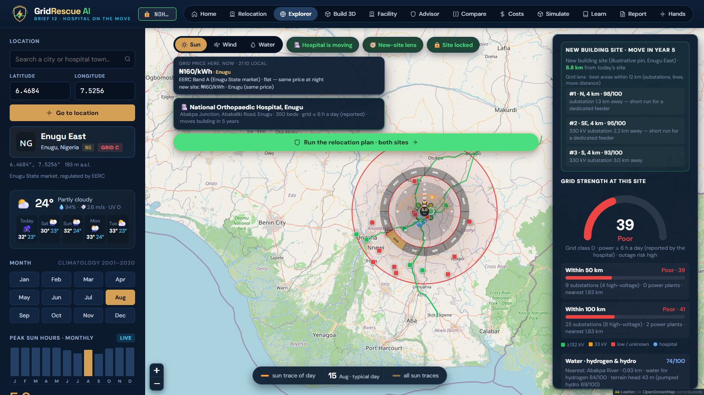<br/>**Sun lens + grid scan.** Peak-sun hours month by month (NASA POWER, PVGIS, PVWatts, Global Solar Atlas); grid strength within 50 and 100 km from OpenStreetMap substations and lines; reported supply hours; the published tariff beside the pin. | 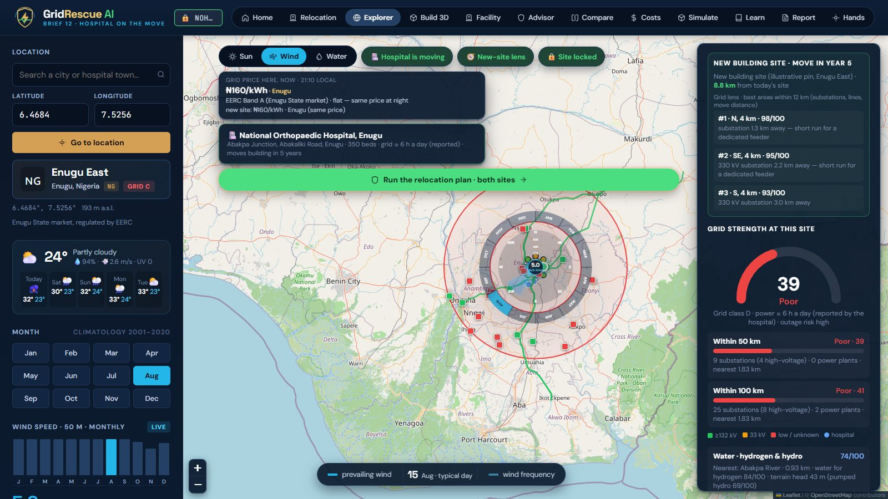<br/>**Wind lens.** 50 m wind speed by month and an hourly wind rose (NASA POWER, ERA5), with the energy a turbine could capture. |
| 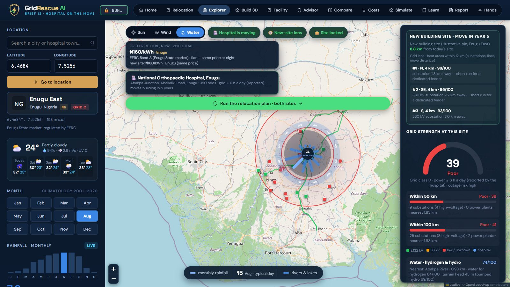<br/>**Water lens.** Rainfall, the nearest river and its discharge (GloFAS), terrain head — water for hydrogen or micro-hydro. | 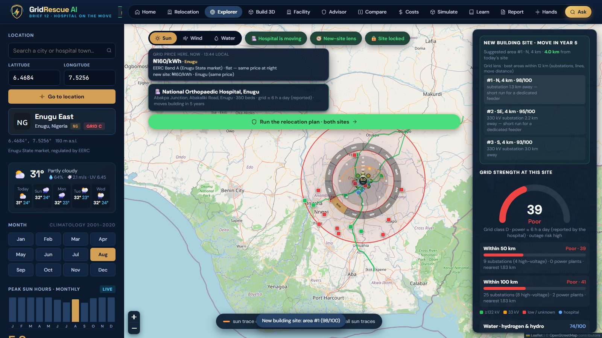<br/>**The hospital is moving.** The new-site lens ranks areas within 12 km by grid access and move distance; pick one and lock the site. |
| 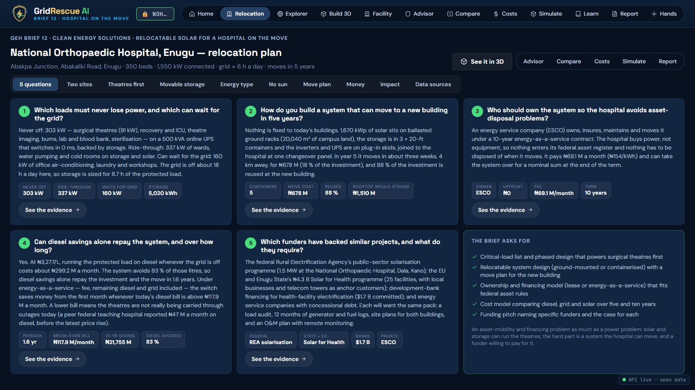<br/>**The relocation plan** answers Brief 12's five questions with this site's numbers, each linked to its evidence. | 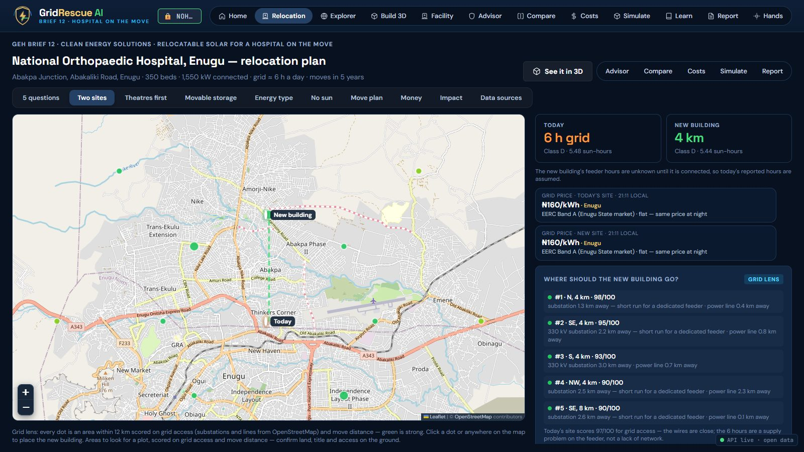<br/>**Two sites**: today and the new building, grid price at each, a grid-first feeder check, sun confirmed by four sources. |
| 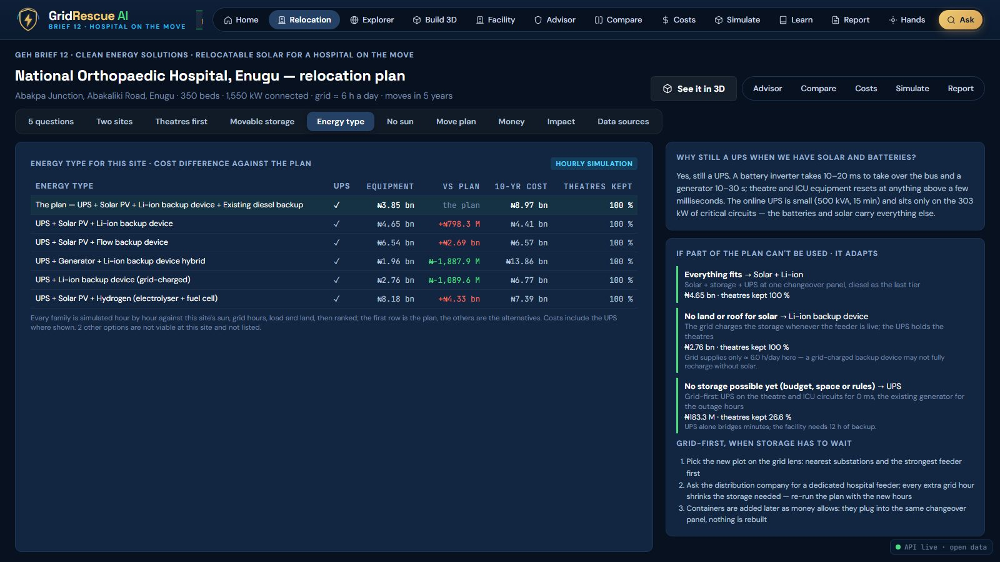<br/>**Energy type.** Every storage family simulated against this site (LFP containers, flow, hydrogen, …); if storage cannot be afforded yet the plan adapts: grid first, UPS on the theatres. | 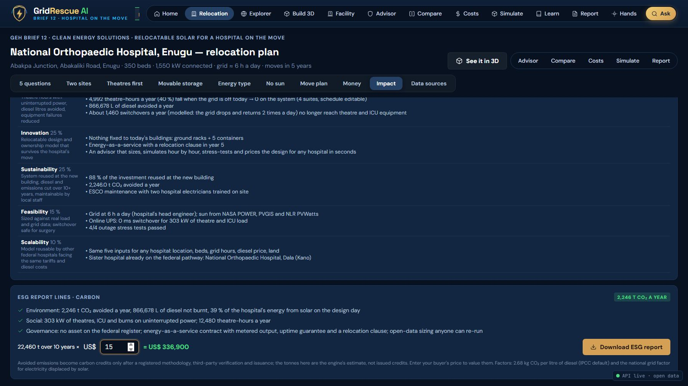<br/>**Impact.** The Three A's, diesel and CO₂ avoided, ESG lines, carbon value at the buyer's price — and **Download ESG report**. |

Also in the app: **Ask GridRescue** (top bar — answers with numbered sources from the internal knowledge base), **Facility** (the cost calculator and the live ML pick — diesel price, tariff and exchange rate with their sources, reported grid hours, the load), **Advisor** (recommendation, sizing, ranked options, affordability, investment case), **Compare** (8 architectures side by side), **Costs** (EPC split, cumulative cost vs diesel), **Learn**, **Report** (printable HTML / PDF / JSON) and **Hands** (walk the same design with one hand in front of the webcam, on-device MediaPipe hand tracking, or with the mouse).

---

## Simulation types

Every result is checked by an **hourly dispatch simulation**: solar and wind first, then storage, then the generator, shedding non-essential load first; critical load (theatres, ICU, burns) must never lose power.

| Simulation | Where | What runs |
|---|---|---|
| **Outage cases on the map** | Explorer → *Simulate this outage* | Evening load-shedding 6 h · overnight outage 12 h · national grid collapse 24 h · daytime feeder fault 4 h |
| **Outage survival (any start hour)** | Advisor | The outage is started at each of the 24 hours of the day, for 4, 8, 12, 18 and 24 h; the share of starts in which the critical load is fully served — the resilience measure used by NREL's REopt |
| **Stress tests on every design** | Advisor · Simulate · Plan | 12 h evening outage (the design case) · 24 h national grid collapse · worst solar month · 18 h longer outage — a design passes only if the critical load is served in all four |
| **The hospital's own site in 3D** | Simulate (`/simulation`) | The real building on the map with ground-mount solar, battery containers, theatre UPS and generator; play or scrub the day, energy flows animate, outage timeline UPS 0 ms → storage + sun carry → grid back |
| **Any location, through any lens** | Simulate, after picking a place | Pick a different place in the Explorer and open Simulate: the engine runs for that place, and the scene, the card and the report are tagged with it (place, coordinates, sun · wind · water, grid). The **Sun · Wind · Water** lens picks the design that uses that resource — solar, a wind turbine, or water (hydrogen from the site's water, or river-linked) — and says plainly when the resource is not viable there (e.g. wind in Kano at 4.3 m/s) |
| **Build 3D · hospital** | Build 3D (`/build`) | Step-by-step site build (sun, wind or water; storage; controls; generator) and a 72-hour test: thunderstorm 6 h · safety shut-off 36 h · winter storm 48 h · hurricane landfall 72 h, with the simulation graphs |
| **Build 3D · night maintenance crew** | Build 3D → *2 · Maintenance work* | A rail crew's diesel generator replaced by a depot-charged battery trailer; three night shifts in a row, or three cloudy ones; noise 45 dBA vs 68 dBA |

| | |
|---|---|
| <br/>**Overnight outage, 20:00** — the grid is out, the UPS switched in 0 ms, storage and sun carry the theatres; all four outage cases covered. | 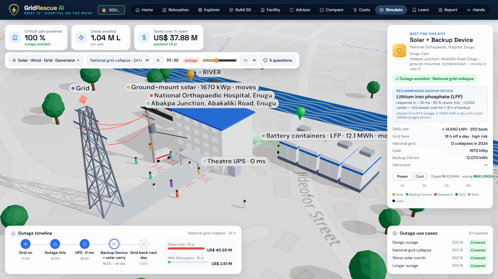<br/>**National grid collapse, 24 h** — storage is resized for the full day; the outage timeline shows grid back the next day. |
| 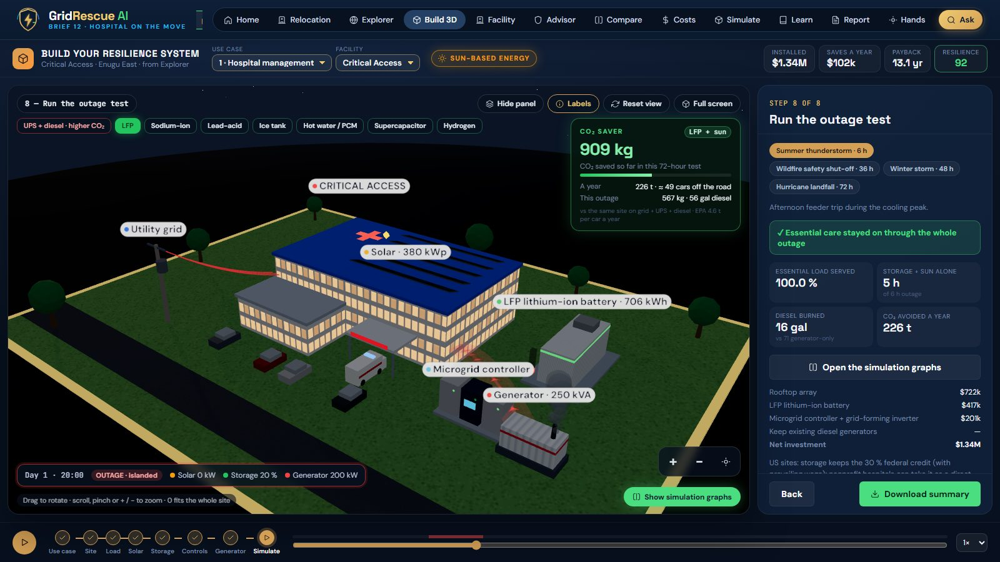<br/>**Build 3D · hospital outage test** — islanded at 20:00, storage and generator carry the essential load. | 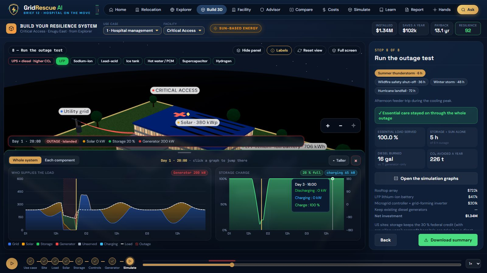<br/>**Simulation graphs** — who supplies the load hour by hour, and the storage charge, for the whole system or each part. |
| 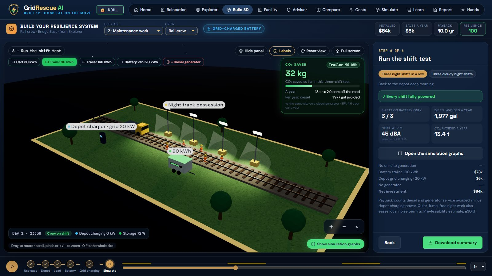<br/>**Night rail crew, 23:30** — the crew on shift on battery power; every shift fully powered. | 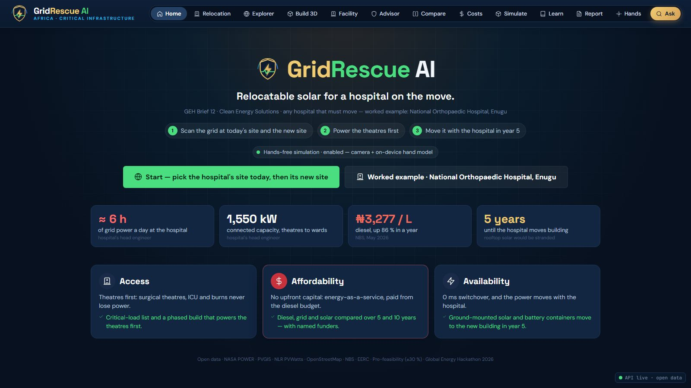<br/>**Home** — the brief's numbers and the Three A's; start from today's site, then the new one. |

---

## ESG report for any site

**Why it matters.** GridRescue does not only show how a site rides through an outage — it gives the ESG overview a greener hospital building needs. Nigeria's Financial Reporting Council is rolling out the ISSB standards (IFRS S1/S2), which ask for Scope 1 and Scope 2 emissions, and calls climate and sustainability governance a core board duty ([FRC roadmap, amended 2026](https://frcnigeria.gov.ng/wp-content/uploads/2026/03/Roadmap-Report-for-the-Adoption-of-IFRS-Sustainability-Disclosure-Standards-in-Nigeria-Amended-2026-.pdf); [FRC, board duty](https://frcnigeria.gov.ng/2025/11/28/climate-and-sustainability-governance-now-a-core-board-duty-frc-tells-directors/)). Hospitals use about 2.5 times the energy of an equivalent commercial building ([IFC EDGE](https://edgebuildings.com/)), and Nigerian hospitals already certify as green buildings ([Evercare Lekki, first EDGE-certified hospital in Nigeria](https://www.thisdaylive.com/2022/05/27/evercare-hospital-lekki-becomes-first-edge-certified-hospital-in-nigeria/)). So the plan becomes an ESG report for the selected site **before anything is bought**.

On the plan's **Impact** tab, on the **Simulate** page and on the **Report** page, **Download ESG report** produces a self-contained report for the site the user selected — the facility name, place and coordinates, the lens (Sun · Wind · Water) and the design shown for it — and:

- emissions by **GHG Protocol scope**: Scope 1 (diesel burnt on site, today vs with the plan) and Scope 2 (the change in grid electricity bought while the grid is on — solar used during an outage is counted once, as diesel not burnt), totals a year and over 10 years;
- **Environment · Social · Governance** report lines;
- the **Three A's** for this site when the relocation plan ran;
- the system behind the numbers and the site (grid class, supply hours, sun, protected load);
- **carbon credits**: avoided tonnes × the price the buyer enters — clearly marked as potential, not issued;
- method, factors (2.68 kg CO₂/L diesel, national grid factor) and sources, with a **Save as PDF** button.

`POST /api/report/esg` builds it from the engine's own result; nothing is hard-coded to Enugu (the Playwright suite downloads it for Enugu and for Kano and checks each is about its own site).

<p align="center">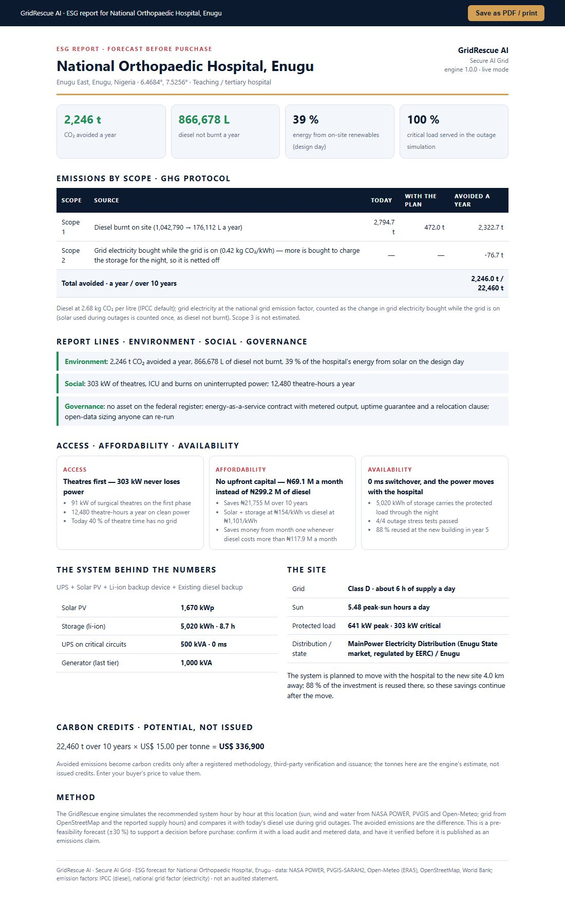</p>

---

## System architecture

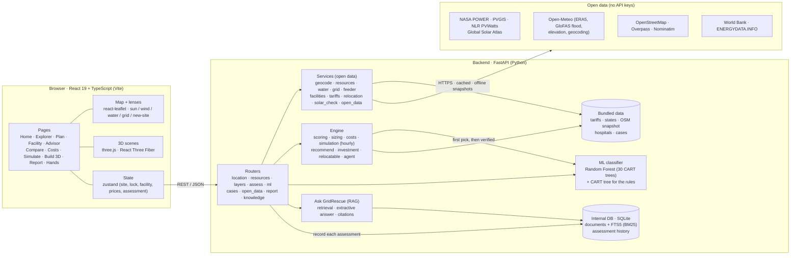

* **Engine** (pre-feasibility, ±30 %): site scores (solar, wind, water, micro-hydro, pumped hydro, hydrogen water, grid reliability) → hospital load model (critical / essential / non-essential) → nine architectures sized and costed → hourly simulation with the outage → nine weighted scoring dimensions (response speed, duration fit, site, CAPEX, lifecycle cost, simplicity, healthcare suitability, clean share, expansion) → stress tests → recommendation, investment case and, when the hospital is moving, the relocation case (phases, move plan, ownership, 5- and 10-year costs, funders, Three A's, ESG).
* **Agent** (`engine/agent.py`): a deterministic, tool-using loop returned with every assessment — observe → classify with the ML model → verify with the hourly simulation → stress-test → affordability → decide, with mitigations when a test fails. Every step records its evidence; no external AI service or key is needed.
* **Prices are published figures only** (`backend/app/data/tariffs.json`, each with its source).

Component responsibilities, interfaces, storage and design decisions: [docs/architecture.md](docs/architecture.md).

### The ML model — classical supervised classification

**What it answers.** Which family of energy system suits this facility's configuration at this site: solar + battery, solar + battery + generator, generator + battery, grid-charged battery, solar + wind + battery, wind + battery, solar + flow battery, solar + hydrogen, pumped hydro or UPS only.

**Algorithm.** A **Random Forest** — 30 **CART decision trees** (Gini impurity), each grown on a bootstrap sample of the training sites and choosing every split among a random √(21) ≈ 5 of the 21 inputs (bagging + random feature subsets). The trees vote; the share of the vote is the probability of each family. A single CART tree trained on the same data gives the **readable rules** shown beside the pick (for example *required backup ≤ 36 h AND solar ≥ 4.2 peak-sun hours*). Pure Python, no ML library (`backend/app/ml/backup_classifier.py`).

**Why a Random Forest.** The inputs are a small set of mixed numeric and yes/no features (tabular data), where tree ensembles are the strongest classical method; they need no scaling, give probabilities, train in minutes on a laptop, and stay explainable through the tree's rules and the feature importances.

**Inputs (21).** The **configuration of the hospital or other infrastructure** — its kind (hospital, clinic, telecom/data, cold chain, water works, school, other), average and protected load, the critical share, the backup hours required, roof and land area, an existing generator — and the **site** — grid supply hours and class, solar and worst-month solar, wind at 50 m, terrain head, flowing water — plus the diesel price.

**Training data.** 10,000 synthetic sites across ten kinds of infrastructure, each **labelled by the full engine** (sizing, 24-hour dispatch through an outage, nine-criterion scoring), so the model learns the engine's decisions: `cd backend && python -m app.ml.train_backup_classifier`.

**Accuracy on 2,000 unseen sites.** Random Forest **80.4 %** (top-2: **94.5 %**) · single decision tree 76.9 % · always guessing the most common answer 46.5 %. Model card: `GET /api/ml/model`.

**Where it shows.** The **Advisor** page ("ML pick · best-suited system": family, share of the vote, top three, the rules, and whether the hourly simulation agrees), the **Facility** page (the pick updates live as you change the configuration — `POST /api/ml/predict`), the **Simulate** page and the agent's trace. **The hourly simulation decides**: the ML pick is the fast first answer, and when the simulation prefers another design the page says so. Rare designs (wind-only, flow batteries) are under-represented in the training labels, which is one more reason the simulation verifies every pick.

Model card: [MODEL_CARD.md](MODEL_CARD.md).

### Ask GridRescue — retrieval-augmented answers over an internal database

* **Internal database:** one **SQLite** file (Python standard library, no server, created on start under `backend/.cache/`, git-ignored). Table `documents` holds GridRescue's own knowledge — the 15 technologies, cost references, the 10 kinds of infrastructure, published tariffs, data sources, the Brief 12 case and its references, how the selection, stress tests, ESG, relocation, scaling and security work, and the ML model card — with an **FTS5 full-text index** (BM25 ranking, Porter stemming). Table `assessments` keeps a short record of every assessed site (place, design, ML pick and whether the simulation agreed, CO₂ avoided), shown on **Report → History**.
* **Retrieval-augmented answers:** the **Ask** button (top bar, every page) retrieves the best passages for a question — plus the user's own assessment when the question is about "this site" — and builds the answer **only from those passages, with numbered citations** to each source.
* **No AI language model is used yet.** The answer is extractive; `generate()` in `backend/app/services/knowledge.py` is the single place where a language model can be connected later (`GR_LLM_PROVIDER`), with the same retrieval, sources and citations.
* Endpoints: `POST /api/ask`, `GET /api/kb/search`, `GET /api/kb/stats`, `GET /api/history`.

---

## Data flow

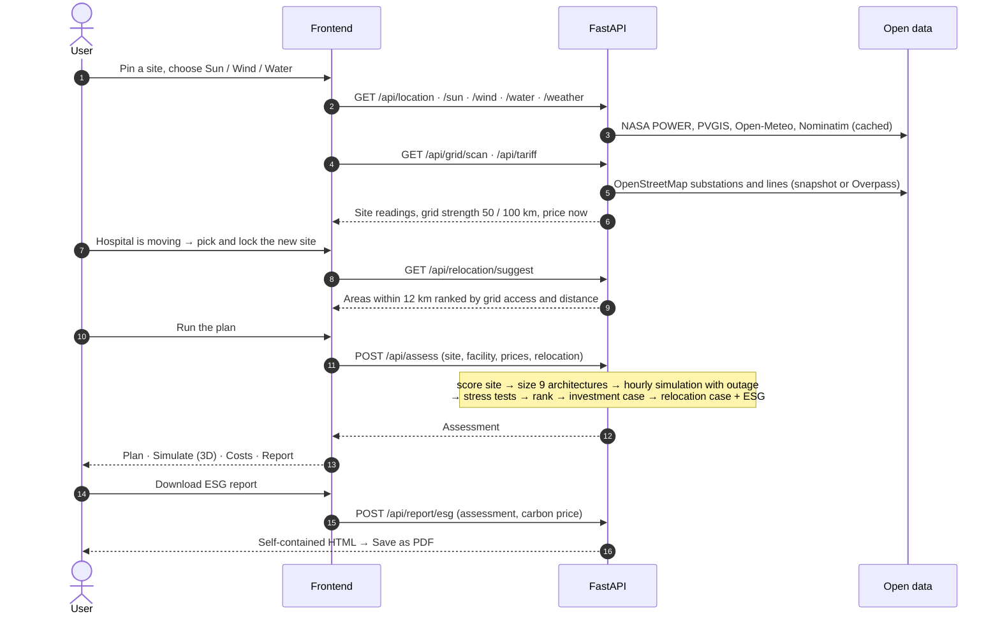

---

## Methodology

**Input** (map pin, facility, prices) → **preprocessing** (open data read and cached, or offline snapshots; design sun hours from the worst month) → **load model** (critical, essential, non-essential) → **sizing** of nine architectures → **hourly dispatch** through the outage → **scoring** on nine weighted criteria → **stress tests** and **outage survival** → **outputs** (recommendation, investment case, relocation case, ESG) → **validation** (pytest regression tests, the classifier's held-out evaluation, Playwright GUI tests).

Formulas, parameters, assumptions and threats to validity: [docs/methodology.md](docs/methodology.md).

---

## Installation and quick start

Prerequisites: **Python 3.11–3.13** and **Node.js 22.12 or newer** (the dev server alone runs on Node 20.19+). No API keys.

**Windows, one click.** Double-click `START.bat`. It checks Python and Node.js, installs the backend and frontend packages on the first run, starts the API and the app in two windows, waits until both answer and opens http://localhost:5173. If the app is already running it just opens it. Close the two server windows to stop.

**Linux / macOS.**

```bash
./start.sh            # Ctrl+C stops both servers
```

**Manual.**

```bash
git clone https://github.com/pavangemmanjunath-cell/GridRescue_AI.git
cd GridRescue_AI

# backend (FastAPI on 127.0.0.1:8000, interactive docs at http://localhost:8000/docs)
cd backend
python -m venv .venv
# Linux / macOS: source .venv/bin/activate      Windows: .venv\Scripts\activate
pip install -r requirements.txt
python -m uvicorn app.main:app --port 8000

# frontend (second terminal; Vite on :5173, proxies /api to :8000)
cd frontend
npm ci
npm run dev
```

**Quick start without the web app** (a few seconds, from the repository root after installing the backend):

```bash
python examples/quickstart.py             # the Enugu worked example, from live open data
python examples/quickstart.py --offline   # bundled snapshots only
```

It prints the design (1,670 kWp solar, 5,020 kWh storage, 500 kVA UPS, the existing 1,000 kVA generator last), 100 % of the critical load served, 4/4 stress tests, 866,678 L of diesel and 2,246 t of CO₂ avoided a year. Offline, the design is the same and the hourly weather is modelled, giving 845,654 L and 2,344 t. See [examples/](examples/).

**Offline / venue mode:** set `GR_OFFLINE=1` before starting. **Production build:** `cd frontend && npm run build && npm run preview`.

---

## Usage

| Task | How | Output |
|---|---|---|
| Plan a site | App: Explorer → pin → lenses → Facility → Advisor | Ranked designs, simulation, stress tests, costs |
| A hospital that must move | App: Home → worked example → new-site lens → lock → plan | The relocation plan answering Brief 12's five questions |
| ESG report | App: Plan › Impact, Simulate or Report → **Download ESG report** | Self-contained HTML, save as PDF |
| Ask a question | App: **Ask** in the top bar | Answer with numbered sources |
| Script it | `curl -X POST localhost:8000/api/assess -H "Content-Type: application/json" -d '{"location":{"lat":6.4684,"lng":7.5256},"facility":{"type":"hospital_tertiary","beds":350,"backup_hours":12}}'` | Assessment JSON |
| Engine only | `python examples/quickstart.py --lat <lat> --lng <lng> --type <type> --beds <n>` | Summary in the terminal |

---

## Dataset

- **Open data read at run time** (not redistributed): NASA POWER, PVGIS, PVWatts, Global Solar Atlas, Open-Meteo, OpenStreetMap, World Bank. Real, public data; each service's terms apply.
- **Bundled snapshots** in `backend/app/data/`: an OpenStreetMap extract for Nigeria (**ODbL**, © OpenStreetMap contributors), published tariffs with sources, state grid-reliability defaults, curated hospital lists and the Brief 12 case file. Values marked "assumed" in the case are still to be confirmed with the hospital.
- **Synthetic training sites** for the classifier: 10,000 sites generated and labelled by the engine (seed 2026). Simulated, not real, and regenerated on demand.
- No personal, patient or customer data.

Sources, licences, schema, biases and redistribution rights: [DATA_CARD.md](DATA_CARD.md).

---

## Reproducing the research

```bash
python examples/quickstart.py                        # 1. the worked example (README figures, live data)
cd backend && pytest                                  # 2. all backend tests, offline, including the worked example
python -m app.ml.train_backup_classifier --out ../benchmarks/results/backup_classifier_repro.json   # 3. retrain and evaluate the classifier (about 10 min)
```

The engine is deterministic. The classifier uses seed 2026; the reproduction run gives a model file byte-identical to the shipped one. Environment, configuration, expected outputs and sources of non-determinism: [docs/reproducibility.md](docs/reproducibility.md).

---

## Benchmarks

Formal benchmarks against other planning tools or measured installations are under development. The reproducible evaluation today is the classifier's agreement with the engine on 2,000 held-out synthetic sites:

| Model | Held-out accuracy |
|---|---|
| Random Forest, 30 trees | **80.4 %** (top-2: 94.5 %) |
| Single CART tree | 76.9 % |
| Most-common-family baseline | 46.5 % |

This measures agreement with the engine, not correctness in the field. Details and the machine-readable result: [benchmarks/](benchmarks/), [MODEL_CARD.md](MODEL_CARD.md).

---

## Tests

```bash
cd backend  && pytest                 # 63 tests: engine maths, energy balance, API contracts, investment and relocation cases, ESG report, open data, ML model, knowledge base, Ask, history, the worked example
cd frontend && npm test               # 23 vitest unit tests (formatters, 3D build engine, frame interpolation)
cd frontend && npx tsc -b             # type-check
cd frontend && npm run e2e            # Playwright GUI tests (backend + dev server running)
```

The Playwright suite drives the app like a user: every page; the Explorer lenses, layers and grid scan; the Enugu story end to end; a generic site (Kano); the Build 3D studio on three screen sizes; the hands-free page with the mouse; and the QA spec `e2e/qa.spec.ts`:

* **lenses** — sun, wind and water each return plausible readings for the site, and the month changes them;
* **ESG report** — downloads for Enugu with the carbon price, and for Kano with nothing of Enugu in it; no timestamp; it opens as a page;
* **cost calculator** — a cheaper diesel price gives a slower payback;
* **3D** — the hospital site, the 24 h collapse and the Build 3D hospital and rail scenes draw (non-blank canvas), the clock runs into the outage, all four outage cases are covered;
* **ML and Ask** (`e2e/ml-ask.spec.ts`) — the Facility page's ML pick appears and changes the way the engine would (3 days of backup → more generator share); the Advisor shows the pick, its rules and the simulation's verdict; Ask answers with numbered sources, uses my assessment for "this site" questions and says when it does not know; the history lists the assessed site;
* **location simulation** (`e2e/location-sim.spec.ts`) — from the Enugu case to Jos: Simulate runs for Jos and is tagged with it; Sun → solar, Wind → the wind design with its turbine, Water → hydrogen; the ESG report is for Jos and the wind design; Kano's Wind lens says wind is not viable; Lokoja's Water lens shows the river.

Screenshots and traces go to `frontend/e2e-results/` (git-ignored). The README pictures are made by `node frontend/scripts/readme_shots.mjs`.

---

## Demo and submission package

- **Demo video** (under 5 minutes, recorded from the running app): [`FINAL_DOC/3_DEMO_VEDIO/`](FINAL_DOC/3_DEMO_VEDIO/)
- **Pitch video** (under 5 minutes): [`FINAL_DOC/4_Pitch_VEDIO/`](FINAL_DOC/4_Pitch_VEDIO/)
- **Screenshots**: [The journey in the app](#the-journey-in-the-app) and [Simulation types](#simulation-types) above.

All final hackathon documents are in [`FINAL_DOC/`](FINAL_DOC/):

| Folder | Contents |
|---|---|
| `1_POC_ONE PAGER/` | POC summary (4 pages) and the one-page **Access · Affordability · Availability** sheet, as DOCX and PDF |
| `2_PPT_Template_5_slides/` | The 5-slide pitch deck (PPTX and PDF) |
| `3_DEMO_VEDIO/` | Demo video — the proof of concept, recorded from the running app (MP4) |
| `4_Pitch_VEDIO/` | Pitch video — the hospital customer and the GridRescue advisor (MP4) |

Large video files: GitHub accepts files up to 100 MB by `git push` (the web uploader stops at 25 MB).

---

## How it scales

**Worldwide.** Sun, weather, rivers and grid come from global open datasets, so any pin on the map works; a new country needs only its **tariff table**. Nothing is hard-coded to Enugu — it is the worked example, and the same flow runs for Kano or any other site (tested).

**Many use cases, one engine.**

| Use case | Status |
|---|---|
| Hospital on today's site and the next | built |
| Night maintenance crew (rail) off diesel | built |
| Utilities: weak feeders, grid-first options | built (feeder check, grid lens) |
| Clinic cold storage on the same supply | extension |
| Surplus solar shared with the grid or neighbours where tariffs allow | extension |
| Charging points in the hospital car park | extension |
| Telecom towers and other critical sites | extension |

**More outage types.**

| Outage type | Level | Status |
|---|---|---|
| Evening load-shedding, overnight, longer outage, daytime feeder fault | site | built |
| National grid collapse (24 h) | grid | built |
| Worst solar month | site / weather | built |
| Feeder or substation trip, scheduled band cuts, frequency collapse | grid | extension |
| One feeder, district or state market out together (location-based outage groups) | location | extension |
| Storm, flood, heat wave | location / weather | extension |
| **Cyber-security outages** that cut power or controls | grid / site | extension, as further stress scenarios |

**Live data.** Next steps: IoT / meter telemetry from the installed system (a meter log already replaces the load estimate when present), and utility feeder planning on the same map.

**Security and trust, built in today.**
* No API keys and no secrets in the code; no personal data is collected — inputs are a map pin and facility figures.
* Every input is validated server-side (coordinate ranges, sizes); the engine runs on the server, read-only on open data.
* Offline mode (`GR_OFFLINE=1`) runs from bundled snapshots, so a site visit works without internet; every number shows its source and whether it is live or model.
* Vendor-neutral: the ranking cannot be bought.

For a production deployment: sign-in and roles per hospital, HTTPS, rate limiting, audit logs of each report, and signed report files.

---

## Known limitations

| Today | Next |
|---|---|
| The hospital's own load profile, generator logs and diesel bills are not yet received; the load comes from bed-based benchmarks | Upload a meter or generator log (hourly CSV) and size from it — the case's consumption endpoint already reads a meter log when one is present (`/api/cases/noh-enugu/consumption`); the next step is to feed it into the assessment |
| The outage simulation runs on a typical design day (24 h); outages longer than a day are approximated by the 24 h national-collapse case | A full-year (8,760 h) simulation and multi-day outages |
| Costs are pre-feasibility (±30 %) from published libraries | Two local EPC quotes against the sizing sheet |
| The new building site in the worked example is an illustrative pin | The hospital's real plot |
| The ML model rarely sees wind-only or flow-battery designs, so it does not pick them; the hourly simulation still checks every pick | More training sites in windy and deep-cycling conditions |
| Ask GridRescue answers by retrieval only (no language model) | Connect a language model behind the same retrieval and citations |

The full list, including data, model, generalisation, security and licensing notes: [docs/limitations.md](docs/limitations.md).

---

## Call for contributions

GridRescue AI is open for contributions from engineers, researchers, students and anyone who knows a grid, a hospital or a tariff. These tasks are open now. Pick one, comment on its issue or open one, and branch from `develop` as described in [CONTRIBUTING.md](CONTRIBUTING.md).

| Task | Good for | Branch prefix |
|---|---|---|
| Add a **tariff table** for a new country, each price with its published source | first contribution, energy policy | `feature/` |
| Feed an uploaded **meter or generator log** (hourly CSV) into the sizing | Python, energy data | `feature/` |
| A **full-year (8,760 h) simulation** with multi-day outages | energy modelling | `research/` |
| New **outage types** as stress scenarios: feeder or substation trips, frequency collapse, storms, floods, heat waves, cyber-security incidents | power systems, resilience | `research/` |
| **Compare the engine** with a full-year tool or with measured data from an installed system | validation, research | `benchmark/` |
| Improve the **classifier**: more windy and deep-cycling sites, calibration, gradient-boosted trees | ML | `research/` |
| Connect a **language model** behind Ask, keeping retrieval and citations, and evaluate faithfulness | NLP | `research/` |
| **Health-facility registry adapters** for `backend/app/data/external/` | data engineering | `feature/` |
| Run the **Playwright GUI tests in CI** | DevOps, testing | `feature/` |
| **Translations** and accessibility of the interface | frontend, i18n | `feature/` |
| Check **emission factors, cost references and load benchmarks** against local sources | domain experts | `docs/` or `fix/` |

Bug reports, reproducibility reports ("I ran it and got …") and documentation fixes are just as welcome. Use the issue forms: bug report, feature request or research question. Contributors are credited in [AUTHORS.md](AUTHORS.md) and in the release notes.

---

## API

| Group | Endpoints |
|---|---|
| Site | `GET /api/location` · `/geocode` · `/site` · `/states` · `/country/{cc}` |
| Resources | `GET /api/sun` · `/wind` · `/water` · `/weather` · `/hourly` · `/climate` · `/solar-check` · `/solar-atlas` |
| Grid and prices | `GET /api/grid` · `/grid/scan` · `/grid/feeder` · `/grid/geojson` (for QGIS) · `/tariff` · `/energydata` |
| Facilities | `GET /api/facilities` · `/hospitals/featured` · `/facility-types` · `/health-data/providers` · `POST /api/load-model` |
| Plan | `POST /api/assess` · `GET /api/technologies` · `/relocation/suggest` · `/cases` · `/cases/{id}` · `/cases/{id}/consumption` |
| Reports | `POST /api/report` (full assessment, HTML) · `POST /api/report/esg` (ESG report, HTML) · `GET /api/sources` |
| ML | `POST /api/ml/predict` (pick for a configuration: probabilities + rules) · `GET /api/ml/model` (model card) |
| Knowledge | `POST /api/ask` (answer with sources) · `GET /api/kb/search` · `GET /api/kb/stats` · `GET /api/history` |
| Health | `GET /health` |

Interactive docs: `http://localhost:8000/docs`.

---

## Open data sources

| Source | Used for |
|---|---|
| [NASA POWER](https://power.larc.nasa.gov/) | 20-year climatology: irradiance, wind 10 / 50 m, temperature, rainfall |
| [PVGIS (EU JRC)](https://re.jrc.ec.europa.eu/pvg_tools/en/) · [NLR PVWatts](https://developer.nrel.gov/docs/solar/pvwatts/) · [Global Solar Atlas](https://globalsolaratlas.info/) | solar yield cross-check (four sources) |
| [Open-Meteo](https://open-meteo.com/) (forecast, ERA5 archive, GloFAS flood, elevation, geocoding) | weather, hourly wind rose, river discharge, terrain head, place search |
| [OpenStreetMap](https://www.openstreetmap.org/copyright) (© OpenStreetMap contributors, ODbL) · [Overpass](https://wiki.openstreetmap.org/wiki/Overpass_API) · [Nominatim](https://nominatim.org/) · [Geofabrik Nigeria](https://download.geofabrik.de/africa/nigeria.html) | substations, power lines, plants, hospitals, rivers; reverse geocoding |
| [World Bank Indicators](https://data.worldbank.org/) · [ENERGYDATA.INFO](https://energydata.info/) | electricity access, outages, grid datasets |
| Published tariffs: NERC, EERC (Enugu), EPRA (Kenya), Eskom, PURC | price at the local hour |
| NBS price watch | diesel price |

---

## Repository structure

```
GridRescue_AI/
├─ backend/                 FastAPI service and the planning engine
│  ├─ app/routers/          location · resources · layers · assess · ml · cases · open_data · report (incl. ESG) · knowledge
│  ├─ app/services/         open-data clients, grid scan, feeder check, tariffs, new-site lens, solar check, knowledge base
│  ├─ app/engine/           profiles · scoring · sizing · costs · simulation · recommend · investment · relocatable · resilience · agent
│  ├─ app/ml/               Random Forest + CART classifier and its training script
│  ├─ app/data/             snapshots (OSM extract under ODbL), tariffs, states, hospitals, Brief 12 case, trained model
│  ├─ scripts/, tools/      API health check, OSM snapshot builder
│  └─ tests/                pytest, incl. the worked example
├─ frontend/                React 19 + TypeScript + Vite
│  ├─ src/pages/            Home · Explorer · Facility · Advisor · Compare · Costs · Simulate · Learn · Report
│  ├─ src/case/             the relocation plan (Brief 12)
│  ├─ src/build/            Build 3D studio and its engine
│  ├─ src/components/       map, lenses, 3D site, ML card, Ask, UI
│  ├─ e2e/                  Playwright specs
│  └─ scripts/              readme_shots.mjs, copy-mediapipe.mjs
├─ examples/                quickstart.py
├─ benchmarks/              classifier evaluation and its results
├─ docs/                    architecture, methodology, positioning, use cases, reproducibility, impact, limitations, release guide, release notes
├─ assets/readme/           the pictures in this README
├─ FINAL_DOC/               hackathon submission: POC summary, one-pager, deck, demo and pitch videos
├─ .github/                 CI, issue forms, pull-request template, Dependabot
├─ START.bat · start.sh     one-click start
├─ CITATION.cff · LICENSE · NOTICE · MODEL_CARD.md · DATA_CARD.md
└─ CONTRIBUTING.md · CODE_OF_CONDUCT.md · SECURITY.md · SUPPORT.md · CHANGELOG.md · ROADMAP.md · AUTHORS.md
```

---

## Research paper

Associated publication information will be added when available.

---

## Software citation

Cite the software with the metadata in [CITATION.cff](CITATION.cff); GitHub's **Cite this repository** button on the repository page gives APA and BibTeX. A software DOI will be added here once the first release is archived on Zenodo.

```bibtex
@software{manjunath_gridrescue_ai_2026,
  author  = {Manjunath, Pavan and Pr{\"u}fer, Thomas},
  title   = {GridRescue AI: open-data planning and hourly outage simulation for relocatable clean backup power at critical facilities},
  version = {1.0.0},
  year    = {2026},
  url     = {https://github.com/pavangemmanjunath-cell/GridRescue_AI},
  license = {Apache-2.0}
}
```

---

## Research impact and adoption

No independently verified entries documented yet. Citations, forks, external contributions and uses are recorded with evidence in [docs/research-impact.md](docs/research-impact.md).

---

## Contributing, roadmap, security and support

- **Contributing:** [CONTRIBUTING.md](CONTRIBUTING.md) — setup, branches (`main` for releases, `develop` for integration), pull requests, research and data contributions. Everyone follows the [Code of Conduct](CODE_OF_CONDUCT.md).
- **Roadmap:** [ROADMAP.md](ROADMAP.md) — current capabilities, near-term work and proposed research.
- **Security:** [SECURITY.md](SECURITY.md) — report vulnerabilities privately, never in a public issue.
- **Support:** [SUPPORT.md](SUPPORT.md) — where to ask questions and report bugs.
- **Changes:** [CHANGELOG.md](CHANGELOG.md) and the [release notes](docs/releases/).

---

## License

The source code is licensed under the [Apache License 2.0](LICENSE). `backend/app/data/osm_ng.json` is OpenStreetMap data under the [Open Database License](https://opendatacommons.org/licenses/odbl/1-0/) (© OpenStreetMap contributors). Third-party notices: [NOTICE](NOTICE).

---

## Authors

- **Pavan Manjunath** — product, AI and engineering · ORCID [0000-0002-2694-8807](https://orcid.org/0000-0002-2694-8807)
- **Thomas Prüfer** — energy systems and the business case

Team **Secure AI Grid**. Contributors are listed in [AUTHORS.md](AUTHORS.md).

---

*GridRescue AI is pre-feasibility decision support (about ±30 %), not a substitute for an engineering study.*
