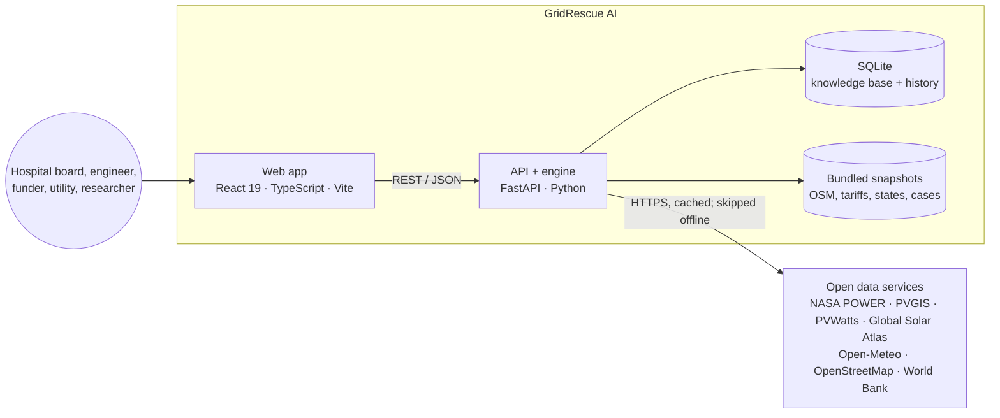
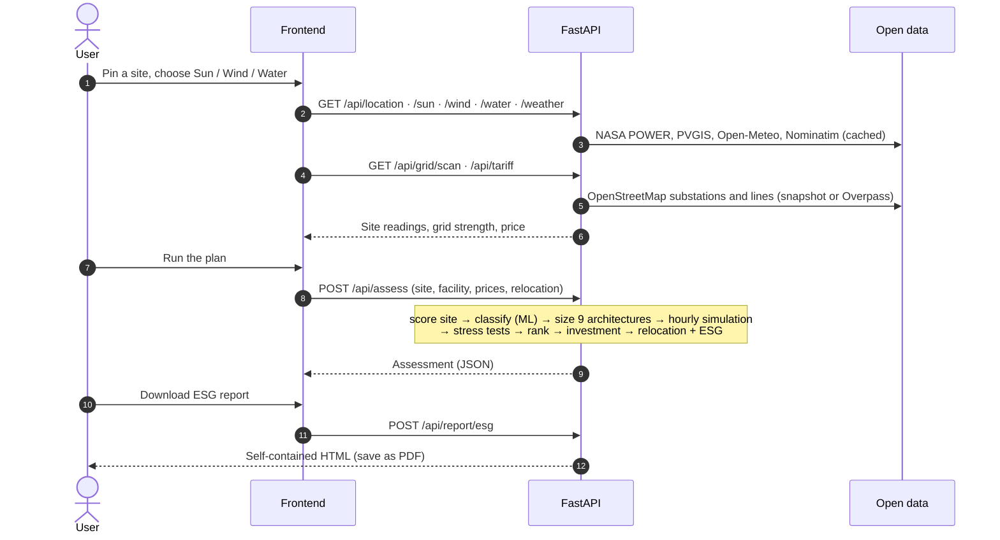
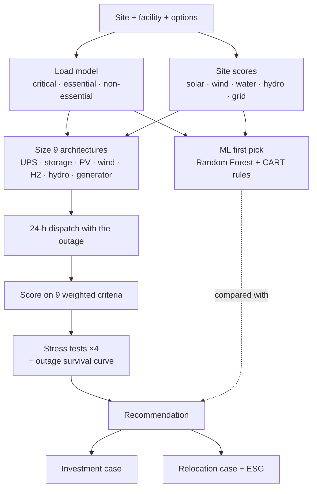

# Architecture

## System Context

GridRescue AI is a two-tier web application. A browser application (React, TypeScript) lets a user pin a site, choose a lens and run a plan. A Python service (FastAPI) reads open data, runs the planning engine and returns JSON or self-contained HTML reports. There is no external database server and no third-party AI service; the internal database is a local SQLite file.

## Major Components

| Component | Location | Responsibility |
|---|---|---|
| Routers | `backend/app/routers/` | HTTP endpoints: location, resources, layers, assess, ml, cases, open data, report (incl. ESG), knowledge |
| Services | `backend/app/services/` | Open-data clients (geocode, resources, water, grid, feeder, facilities, tariffs, relocation, solar check), offline fallbacks, the knowledge base |
| Engine | `backend/app/engine/` | Load profiles, site scoring, sizing, costs, hourly simulation, recommendation and ranking, investment case, relocation case, outage survival, agent trace |
| ML | `backend/app/ml/` | Random Forest + CART classifier and its training script |
| Data | `backend/app/data/` | Bundled snapshots and the trained model (see [DATA_CARD.md](../DATA_CARD.md)) |
| Frontend pages | `frontend/src/pages/`, `frontend/src/case/`, `frontend/src/build/` | Home, Explorer, Facility, Advisor, Compare, Costs, Simulate, Learn, Report, Hands; the relocation plan; Build 3D |
| Frontend state | `frontend/src/store/` | zustand stores: site, lock, facility, prices, assessment |
| 3D | `frontend/src/components/three/` | React Three Fiber scenes of the site, equipment and energy flows |
| Tests | `backend/tests/`, `frontend/src/**/*.test.ts*`, `frontend/e2e/` | pytest, vitest, Playwright |

## Component Responsibilities

- **Engine is pure and deterministic.** It takes a site, a facility and options and returns a dictionary. It does no I/O, so it is testable offline and reproducible.
- **Services own all network access** and fall back to bundled snapshots or modelled values when offline, marking each value's source as live or model.
- **Routers validate input** with Pydantic and assemble the engine's inputs from the services.
- **The frontend never computes results.** It shows what the API returns and formats it.

## Data Flow

## Model/Algorithm Flow

The agent trace (`engine/agent.py`) records each step with its evidence: observe, classify, verify, stress-test, afford, decide.

## Interfaces

- **REST API**, documented interactively at `/docs` (OpenAPI) and summarised in the README's API table.
- **Reports**: `POST /api/report` (full assessment, HTML) and `POST /api/report/esg` (ESG report, HTML).
- **GeoJSON export** of the grid layer for QGIS: `GET /api/grid/geojson`.
- **Language-model hook**: `generate()` in `backend/app/services/knowledge.py`, selected by `GR_LLM_PROVIDER` (not used in v1.0.0).

## Storage

| Store | Where | Content |
|---|---|---|
| HTTP cache | `backend/.cache/` (diskcache) | Open-data responses |
| SQLite | `backend/.cache/gridrescue.db` | `documents` with an FTS5 index; `assessments` history |
| Bundled data | `backend/app/data/` | Read-only snapshots and the model |
| Browser | sessionStorage | The selected site, facility inputs, prices and last assessment for the current tab; cleared when the tab closes |

All runtime storage is local and git-ignored.

## Dependencies

Backend: FastAPI, Uvicorn, httpx, Pydantic, pydantic-settings, diskcache, python-dotenv. Frontend: React, React Router, react-leaflet and Leaflet, three.js with React Three Fiber and drei, Recharts, zustand, MediaPipe Tasks Vision. Licences are listed in [reproducibility.md](reproducibility.md#dependencies).

## Deployment/Execution Model

- **Local development**: Uvicorn on `127.0.0.1:8000` and the Vite dev server on `:5173`, which proxies `/api` to the backend. `START.bat` (Windows) and `start.sh` (Linux/macOS) start both.
- **Offline**: `GR_OFFLINE=1` makes every service use bundled snapshots or modelled values.
- **Static build**: `npm run build` produces `frontend/dist/`, which any static server can host in front of the API.
- No container or cloud deployment is provided in v1.0.0.

## Design Decisions

- **Deterministic engine over a learned end-to-end model.** Every recommendation is explained by an hourly energy balance a reviewer can check. The ML model only gives a first pick.
- **Pure-Python ML.** The forest is small enough to train in minutes without NumPy or scikit-learn, which keeps installation light and the model file plain JSON.
- **Open data without keys.** Any user can run the planner anywhere, and every value carries its source.
- **SQLite with FTS5 for retrieval.** Part of Python's standard library, so there is no server to run, and the extractive answers can be checked against their citations.
- **Vendor-neutral by construction.** Technologies are modelled by chemistry and type, never by product.

## Known Architectural Limitations

- One 24-hour design day per assessment; no full-year time series.
- No authentication, roles or rate limiting.
- Network-dependent services degrade to snapshots, so offline results for sites outside Nigeria rely on modelled climatology.
- The frontend depends on public OpenStreetMap tiles; heavy use needs a tile provider.
